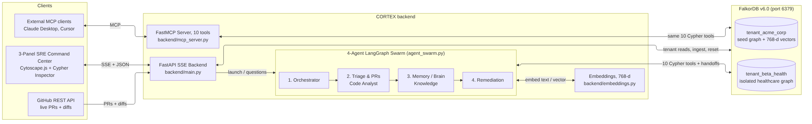
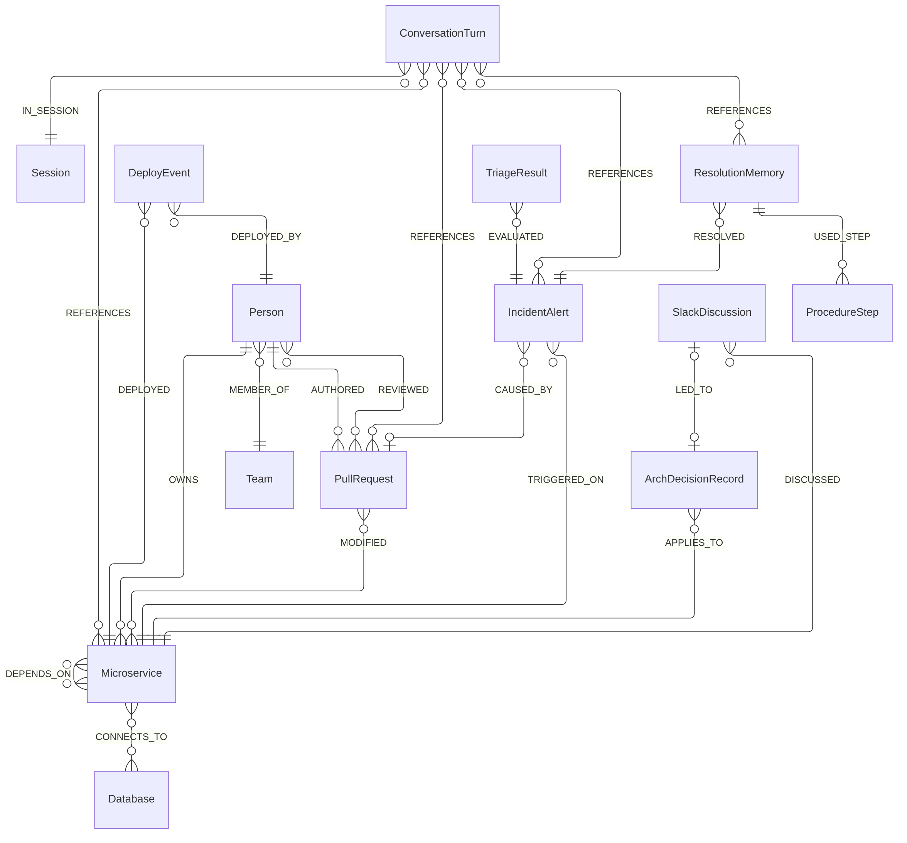

# 🧠 CORTEX — Autonomous SRE, Blast-Radius & Company Brain on FalkorDB

> **Built for Graph Hacks: Context for AI Agents (FalkorDB & WeMakeDevs)**  
> **Tracks Entered:** Track 01 (Agents That Act on Connected Data) • Track 02 (Agent Memory & Coordination) • Track 03 (Company Brain)  
> 🎥 **3-Minute Demo Video:** `[PASTE_YOUR_YOUTUBE_OR_LOOM_LINK_HERE]`  
> 📝 **Technical Blog Post:** `[PASTE_YOUR_DEVTO_OR_HASHNODE_LINK_HERE]`  
> 📄 **License:** MIT

---

## 🚨 The Problem: Why Vector RAG Fails at 2:00 AM

Imagine it is 2:00 AM and an e-commerce company's checkout page starts returning `HTTP 502 Bad Gateway` errors. Customers cannot pay, and the on-call engineer faces dozens of microservices, recent pull requests, and architectural decisions scattered across Slack channels.

Standard Vector RAG chatbots fail during production incidents because **flat vector embeddings suffer from topological blindness**. A flat vector store cannot see that `CheckoutService` depends on `PaymentService`, which depends on `AuthTokenService`, where a developer merged a breaking JWT signing key rotation (`PR-402`) two hours ago.

**CORTEX** solves this in milliseconds by using **FalkorDB** as the active nervous system for a 4-agent LangGraph swarm:
- **Rule #3 Compliance ("The Graph Does the Real Work"):** If FalkorDB is removed, CORTEX cannot function. Every root-cause diagnosis, blast-radius calculation, inter-agent state handoff (`:TriageResult`), hybrid vector-graph runbook lookup (`:ResolutionMemory` ➔ `:ProcedureStep`), and ADR/Slack provenance trace is driven by live OpenCypher traversals over FalkorDB.

---

## 🏆 How CORTEX Covers All 3 Hackathon Tracks

| Track | Official Key Focus Areas | CORTEX Implementation |
|---|---|---|
| **Track 01: Agents That Act on Connected Data** | • Multi-hop reasoning<br>• Graph queries & algorithms as agent tools<br>• Tool selection through MCP<br>• Actions based on what the graph shows<br>• Explainable results | • **4-Hop Root Cause (`Query 1`):** Traverses `Alert ➔ Service ➔ Dependency*1..4 ➔ PR` within a 24h epoch window.<br>• **6-Hop Blast Radius (`Query 2`), Criticality (`Query 3A/3B`), Shortest Path (`Query 4`).**<br>• **FastMCP Server (`backend/mcp_server.py`):** Exposes all 10 FalkorDB tools via Model Context Protocol.<br>• **Autonomous Remediation & Explainability:** Heals degraded services (`Query 6`), renders open **Cypher Inspector** cards, and spotlights `nodes(path)` on the Cytoscape.js canvas. |
| **Track 02: Agent Memory & Coordination** | • Episodic, semantic & procedural memory<br>• Persistent conversation history<br>• Shared state & handoffs between agents<br>• High-concurrency reads & writes<br>• Separate memory per user or tenant | • **Hybrid Vector + Graph Memory (`Query 5A`):** 768-dim cosine similarity (`db.idx.vector.queryNodes`) + graph hop to `:ResolutionMemory` and ordered `:ProcedureStep` runbook nodes.<br>• **Persistent Session History (`Query 7`):** Logs `:ConversationTurn` nodes linked to `:Session` and domain entities via `[:REFERENCES]`.<br>• **Graph-Native Handoffs:** Triage writes `:TriageResult` to FalkorDB; Memory reads it via Cypher.<br>• **Multigraph Tenant Isolation:** Native graph-level isolation (`tenant_acme_corp` vs. `tenant_beta_health`) via `db.select_graph()`. |
| **Track 03: Company Brain** | • Docs, tickets & chats in one graph<br>• Who owns what, and who knows what<br>• Tracing decisions back to source<br>• Keeping knowledge current as things change<br>• Answers with clear sources | • **Unified Knowledge Graph:** Connects `:Microservice`, `:PullRequest`, `:Person`, `:Team`, `:ArchDecisionRecord`, `:SlackDiscussion`, and `:IncidentAlert`.<br>• **Expertise Ranking (`Query 8`) & Provenance (`Query 9`):** Ranks owners/reviewers and traces `SlackDiscussion ➔ ADR ➔ Microservice`.<br>• **Live GitHub REST API Sync (`POST /api/knowledge/ingest`):** Fetches real-time PRs and changed-file diffs from GitHub (`/pulls` & `/files`) into FalkorDB. |

---


## 🏗️ System Architecture



---

## 🕸️ Graph Data Model (Schema)

### Entity-Relationship Diagram



### Node Labels & Key Properties (`backend/seed_graph.py`)

- **`:Microservice`**: `name`, `status` (`healthy` | `degraded` | `down`), `tier` (`1` | `2` | `3`), `language`, `team_owner`, `ui_x`, `ui_y`
- **`:Database`**: `name`, `engine` (`postgres` | `redis`), `host`, `port`, `status`, `ui_x`, `ui_y`
- **`:PullRequest`**: `pr_id`, `title`, `author`, `merged_at_epoch`, `merged_at_iso`, `files_changed`, `changed_files_list`, `diff_summary`, `risk_score`, `risk_label`
- **`:IncidentAlert`**: `alert_id`, `severity`, `severity_rank`, `error_log`, `error_signature`, `error_embedding` (`vecf32`, 768-dimensional if configured), `timestamp_epoch`, `status`, `mttr_minutes`
- **`:TriageResult`**: `session_id`, `alert_id`, `suspect_service`, `suspect_pr`, `blast_radius_count`, `confidence`, `created_at_epoch`
- **`:ResolutionMemory`**: `memory_id`, `solution_summary`, `steps_taken`, `success_rate`, `applied_count`, `created_at_epoch`
- **`:ProcedureStep`**: `step_id`, `runbook_name`, `step_order`, `instruction`, `auto_exec`
- **`:Session` and `:ConversationTurn`**: Session and conversation identifiers, agent name, role, content, and timestamp
- **`:Person` and `:Team`**: `name`, `email`, `role`, `slack_handle`, `github_handle`, `timezone`, `department`, `slack_channel`
- **`:ArchDecisionRecord` and `:SlackDiscussion`**: Decision identifiers, titles, decisions, rationale, status, provenance, thread identifiers, channel, permalink, and summary

---

## ⚡ Essential Cypher Queries (`backend/queries.py`)

All 10 queries use parameterized inputs (`$alert_id`, `$service`, `$query_embedding`), integer epoch comparisons (`86400` = 24h, `604800` = 7d), and numeric risk sorting.

### Query 1: 4-Hop Root Cause Analysis (Track 01)
```cypher
MATCH (a:IncidentAlert {alert_id: $alert_id})-[:TRIGGERED_ON]->(s:Microservice)
MATCH path = (s)-[:DEPENDS_ON*1..4]->(dep:Microservice)
MATCH (dep)<-[:MODIFIED]-(pr:PullRequest)
WHERE pr.merged_at_epoch >= a.timestamp_epoch - 86400
RETURN dep.name AS suspect_service,
       pr.pr_id AS pr_id,
       pr.title AS recent_change,
       pr.author AS committer,
       pr.risk_score AS risk_score,
       pr.risk_label AS risk_label,
       length(path) AS dependency_hops,
       [n IN nodes(path) | n.name] AS dependency_chain
ORDER BY pr.risk_score DESC, dependency_hops ASC
LIMIT 5
```

### Query 2: 6-Hop Transitive Blast Radius (Track 01)
```cypher
MATCH (start:Microservice {name: $compromised_service})
MATCH path = (victim:Microservice)-[:DEPENDS_ON*1..6]->(start)
WITH victim, length(path) AS hops, [n IN nodes(path) | n.name] AS p_nodes
ORDER BY hops ASC
RETURN victim.name AS affected_service,
       victim.tier AS tier,
       min(hops) AS distance,
       collect(p_nodes)[0] AS impact_path
ORDER BY victim.tier ASC, distance ASC
```

### Query 3A / 3B: Infrastructure Criticality via PageRank & Transitive Dependents (Track 01)
```cypher
-- Primary (GraphBLAS PageRank)
CALL algo.pageRank('Microservice', 'DEPENDS_ON')
YIELD node, score
RETURN node.name AS service, node.tier AS tier, node.status AS status, score AS criticality
ORDER BY score DESC LIMIT 10

-- Pure-Cypher Transitive Criticality Fallback
MATCH (target:Microservice)
OPTIONAL MATCH (dependent:Microservice)-[:DEPENDS_ON*1..6]->(target)
WHERE dependent <> target
WITH target, count(DISTINCT dependent) AS dependents_count
RETURN target.name AS service, target.tier AS tier, target.status AS status, dependents_count AS criticality
ORDER BY dependents_count DESC, target.tier DESC LIMIT 10
```

### Query 4: Shortest Dependency Path (Track 01)
```cypher
MATCH (a:Microservice {name: $service_a}), (b:Microservice {name: $service_b})
MATCH p = (a)-[:DEPENDS_ON*1..6]->(b)
RETURN [n IN nodes(p) | n.name] AS path, length(p) AS hops
ORDER BY hops ASC LIMIT 1
```

### Query 5A: Hybrid 768-Dim Vector + Graph Episodic Memory Recall (Track 02)
```cypher
CALL db.idx.vector.queryNodes(
  'IncidentAlert',
  'error_embedding',
  3,
  vecf32($query_embedding)
) YIELD node, score
WITH node AS past, score
MATCH (m:ResolutionMemory)-[:RESOLVED]->(past)
OPTIONAL MATCH (m)-[:USED_STEP]->(step:ProcedureStep)
WITH m, past, score, step
ORDER BY step.step_order ASC
RETURN past.alert_id AS similar_past_alert,
       past.error_signature AS matched_signature,
       score AS vector_similarity,
       m.memory_id AS memory_id,
       m.solution_summary AS recommendation,
       m.success_rate AS confidence,
       m.applied_count AS times_used,
       collect(step.instruction) AS ordered_runbook_steps,
       collect(step.step_id) AS step_ids
ORDER BY score DESC, m.success_rate DESC
LIMIT 3
```

### Query 6: Atomic Resolution Memory Persistence & Service Healing (Track 02)
```cypher
MATCH (a:IncidentAlert {alert_id: $alert_id})-[:TRIGGERED_ON]->(s:Microservice)
SET a.status = 'resolved', a.mttr_minutes = $mttr_minutes, s.status = 'healthy'
WITH a, s
MATCH (svc:Microservice)
WHERE svc.name IN ['CheckoutService', 'AuthTokenService', 'PaymentService', 'OrderService']
SET svc.status = 'healthy'
WITH a, s, collect(svc.name) AS healed_list
CREATE (m:ResolutionMemory {
  memory_id: $memory_id,
  solution_summary: $summary,
  steps_taken: $steps_taken,
  success_rate: 1.0,
  applied_count: 1,
  created_at_epoch: $current_epoch,
  created_at_iso: $current_iso
})
CREATE (m)-[:RESOLVED]->(a)
RETURN m.memory_id AS stored_memory, a.status AS alert_status, s.name AS healed_service
```

### Query 7: Persistent Multi-Agent Session History & Entity References (Track 02)
```cypher
MATCH (t:ConversationTurn {session_id: $session_id})
OPTIONAL MATCH (t)-[:REFERENCES]->(ref)
RETURN t.agent_name AS agent,
       t.role AS role,
       t.content AS message,
       labels(ref) AS referenced_type,
       coalesce(ref.name, ref.pr_id, ref.alert_id, ref.memory_id, '') AS referenced_entity,
       t.timestamp_epoch AS time_epoch
ORDER BY t.timestamp_epoch ASC, t.turn_id ASC
```

### Query 8: Domain Expert & Code Ownership Ranking (Track 03)
```cypher
MATCH (s:Microservice {name: $service})
MATCH (p:Person)
OPTIONAL MATCH (p)-[:AUTHORED]->(pr1:PullRequest)-[:MODIFIED]->(s)
WITH s, p, count(DISTINCT pr1) AS authored, collect(DISTINCT pr1.pr_id) AS authored_prs
OPTIONAL MATCH (p)-[:REVIEWED]->(pr2:PullRequest)-[:MODIFIED]->(s)
WITH s, p, authored, authored_prs, count(DISTINCT pr2) AS reviewed, collect(DISTINCT pr2.pr_id) AS reviewed_prs
OPTIONAL MATCH (p)-[r:OWNS]->(s)
WITH p, authored, authored_prs, reviewed, reviewed_prs,
     CASE WHEN count(r) > 0 THEN true ELSE false END AS is_owner
WHERE authored > 0 OR reviewed > 0 OR is_owner = true
RETURN p.name AS expert, p.role AS role, p.slack_handle AS contact, p.timezone AS tz,
       authored, reviewed, authored + reviewed AS total_involvement, is_owner,
       authored_prs + reviewed_prs AS connected_prs
ORDER BY is_owner DESC, total_involvement DESC LIMIT 5
```

### Query 9: Decision Provenance Trail — ADR + Slack Thread (Track 03)
```cypher
MATCH (s:Microservice {name: $service})
OPTIONAL MATCH (adr:ArchDecisionRecord)-[:APPLIES_TO]->(s)
OPTIONAL MATCH (slack:SlackDiscussion)-[:LED_TO]->(adr)
RETURN s.name AS service,
       coalesce(adr.adr_id, 'NONE') AS adr_id,
       coalesce(adr.title, 'No ADR recorded') AS decision,
       coalesce(adr.rationale, '') AS why,
       coalesce(adr.decided_at_iso, '') AS decided_when,
       coalesce(slack.permalink, '') AS discussion_link,
       coalesce(slack.summary, '') AS discussion_summary,
       coalesce(slack.thread_id, 'NONE') AS thread_id
```

### Query 10: 2-Hop Neighborhood Recent Changes (Track 03)
```cypher
MATCH (s:Microservice {name: $service})
MATCH (neighbor:Microservice)-[:DEPENDS_ON*0..2]-(s)
WITH DISTINCT neighbor
OPTIONAL MATCH (pr:PullRequest)-[:MODIFIED]->(neighbor)
  WHERE pr.merged_at_epoch >= $current_epoch - 604800
WITH neighbor, collect(DISTINCT CASE WHEN pr IS NOT NULL THEN pr.pr_id + ': ' + pr.title ELSE NULL END) AS raw_prs
OPTIONAL MATCH (d:DeployEvent)-[:DEPLOYED]->(neighbor)
  WHERE d.timestamp_epoch >= $current_epoch - 604800
WITH neighbor, raw_prs, collect(DISTINCT d.version) AS recent_deploys
OPTIONAL MATCH (a:IncidentAlert)-[:TRIGGERED_ON]->(neighbor)
  WHERE a.timestamp_epoch >= $current_epoch - 604800
RETURN neighbor.name AS service,
       neighbor.status AS current_status,
       [x IN raw_prs WHERE x IS NOT NULL] AS recent_prs,
       recent_deploys,
       collect(DISTINCT a.alert_id) AS recent_incidents
```

---

## 📊 Audited Performance Benchmarks (`backend/benchmark.py`)

### Testing Methodology
- **Environment:** Dockerized FalkorDB v6.0 + Python 3.11 FastAPI/LangGraph container (`cortex-app`).
- **Protocol:** Uniform warm-up (`WARMUP_RUNS=3`) followed by **`N=20` measured iterations per query** and **`N=20` interleaved, state-isolated iterations per end-to-end execution mode**.
- **State Isolation & Validation:** Before each mutating iteration (outside the timer), `ALERT-901` and affected services are reset to their initial outage state. Every iteration is strictly validated against physical FalkorDB records (`OK/VF/EX` = Validated OK / Validation Failures / Exceptions), and temporary artifacts are cleaned up with full node/relationship invariant verification at completion.
- **Percentile Formula:** Nearest-rank P95 (`ceil(0.95 * n) - 1`).
- **Scope Disclosure:** Measurements capture the deterministic 4-agent Python/LangGraph + FalkorDB execution pipeline (11 live Cypher/vector queries per investigation) excluding external LLM generation network latency.

### 1. All 10 Graph Queries (`N=20` Measured Runs Each after Warm-Up)

| Query Capability | Function (`graph_tools.py`) | Avg | Median | P95 | Min | Max | OK / VF / EX |
|---|---|---:|---:|---:|---:|---:|:---:|
| **Query 1:** 4-Hop Root Cause + PR Risk Sort | `find_root_cause()` | `2.46 ms` | `2.65 ms` | `3.96 ms` | `1.02 ms` | `4.28 ms` | `20 / 0 / 0` |
| **Query 2:** 6-Hop Transitive Blast Radius | `get_blast_radius()` | `0.95 ms` | `0.85 ms` | `1.54 ms` | `0.68 ms` | `1.59 ms` | `20 / 0 / 0` |
| **Query 3:** Infrastructure Criticality | `get_critical_services()` | `1.69 ms` | `1.21 ms` | `5.47 ms` | `0.85 ms` | `6.72 ms` | `20 / 0 / 0` |
| **Query 4:** Shortest Dependency Path | `get_shortest_dependency_path()` | `1.63 ms` | `1.00 ms` | `3.07 ms` | `0.86 ms` | `8.60 ms` | `20 / 0 / 0` |
| **Query 5:** Hybrid Vector + Graph Memory | `recall_incident_memory()` | `3.26 ms` | `3.16 ms` | `4.27 ms` | `2.20 ms` | `4.39 ms` | `20 / 0 / 0` |
| **Query 6:** Store Resolution Memory & Heal | `store_resolution_memory()` | `2.21 ms` | `1.96 ms` | `2.92 ms` | `1.53 ms` | `4.90 ms` | `20 / 0 / 0` |
| **Query 7:** Multi-Agent Session History | `get_session_history()` | `0.94 ms` | `0.92 ms` | `1.14 ms` | `0.72 ms` | `1.35 ms` | `20 / 0 / 0` |
| **Query 8:** Domain Expert Ranking | `get_service_experts()` | `1.63 ms` | `1.49 ms` | `2.26 ms` | `0.91 ms` | `3.49 ms` | `20 / 0 / 0` |
| **Query 9:** ADR + Slack Provenance | `get_decision_provenance()` | `0.87 ms` | `0.84 ms` | `1.15 ms` | `0.62 ms` | `1.34 ms` | `20 / 0 / 0` |
| **Query 10:** 2-Hop Neighborhood Changes | `get_recent_neighborhood_changes()` | `1.27 ms` | `1.24 ms` | `1.68 ms` | `0.99 ms` | `1.70 ms` | `20 / 0 / 0` |

### 2. Controlled 4-Agent End-to-End Workflow Comparison (`20` Interleaved Isolated Runs/Mode, `11` Queries/Run)

| Execution Mode | Avg | Median | P95 | Min | Max | DB Sum (11 Qs) | OK / VF / EX |
|---|---:|---:|---:|---:|---:|---:|:---:|
| **1. Sequential, Unpooled, Uncached** (11 Clients/Run) | `44.30 ms` | `42.90 ms` | `60.43 ms` | `35.61 ms` | `66.79 ms` | `13.01 ms` | `20 / 0 / 0` |
| **2. Sequential, Pooled, Uncached** (0 New Clients) | `13.74 ms` | `12.93 ms` | `18.49 ms` | `10.68 ms` | `23.88 ms` | `12.67 ms` | `20 / 0 / 0` |
| **3. Sequential, Pooled, Cached** (Warm `@lru_cache`) | `12.33 ms` | `11.96 ms` | `17.58 ms` | `9.93 ms` | `20.72 ms` | `11.94 ms` | `20 / 0 / 0` |
| **4. Parallel, Pooled, Cached** (3-Thread Pool) | **`11.03 ms`** | **`10.72 ms`** | **`12.56 ms`** | **`9.41 ms`** | **`14.15 ms`** | `15.08 ms` | `20 / 0 / 0` |
| **5. Compiled LangGraph `.invoke()`** (Parallel) | `16.10 ms` | `14.65 ms` | `25.44 ms` | `13.05 ms` | `31.98 ms` | `16.64 ms` | `20 / 0 / 0` |
| **6. In-Process ASGI HTTP/SSE** (`TestClient`) | `18.90 ms` | `18.25 ms` | `22.52 ms` | `16.07 ms` | `25.43 ms` | `N/A` | `20 / 0 / 0` |

### 3. Single-Variable & Combined Optimization Breakdown

| Isolated Comparison | Measured Effect | Latency Change |
|---|---|---|
| **Pure Connection Pooling Effect** (Mode 1 vs. Mode 2, both Seq/Uncached) | **`3.22x faster`** | `44.30 ms` ➔ `13.74 ms` (`+69.0%` reduction) |
| **Pure Embedding Cache Effect** (Mode 2 vs. Mode 3, both Seq/Pooled) | **`1.11x faster`** | `13.74 ms` ➔ `12.33 ms` (`+10.3%` reduction) |
| **Combined Pooling + Caching Effect** (Mode 1 vs. Mode 3, both Seq) | **`3.59x faster`** | `44.30 ms` ➔ `12.33 ms` (`+72.2%` reduction) |
| **Pure Concurrency Effect** (Mode 3 Seq vs. Mode 4 Parallel, both Pooled) | **`1.12x faster`** | `12.33 ms` ➔ `11.03 ms` (`+10.6%` reduction) |
| **Combined Backend Optimization** (Mode 1 Unpooled Seq vs. Mode 4 Pooled Parallel) | **`4.02x faster`** | `44.30 ms` ➔ `11.03 ms` (`+75.1%` reduction) |

> **Why Cumulative DB Time (`15.08 ms`) Exceeds End-to-End Wall Time (`11.03 ms`) in Mode 4:**  
> `DB Sum` is the scalar sum of all 11 individual query durations ($\sum t_i$), whereas `Avg` (`11.03 ms`) is wall-clock time. Because `agent_swarm.py` executes independent queries concurrently across a 3-worker `ThreadPoolExecutor` (e.g., Queries 1 & 3 in Triage; Queries 6, 7 & 8 in Remediation), parallel queries overlap in time.  
> *(Note: The initial pre-optimization prototype reported `2,540 ms` over SSE because `main.py` contained `2,400 ms` of presentation `asyncio.sleep()` delays. Those delays were removed (`asyncio.sleep(0)`), and `2,540 ms` is retained strictly as a historical UI reference rather than a backend speedup baseline).*

---

## 🔒 Security & Resilience Engineering

CORTEX was audited with **OWASP ZAP 2.17.0** and hardened across all HTTP and database boundaries:
1. **Strict Tenant Isolation (`ALLOWED_TENANTS`):** Every API route and graph tool normalizes and validates `tenant_id` against `{"acme_corp", "beta_health"}` before calling `db.select_graph()`, rejecting unauthorized tenants or path-traversal strings (`../../evil`) with `HTTP 400`.
2. **OWASP HTTP Security Headers:** Enforces `Content-Security-Policy`, `X-Frame-Options: DENY`, `X-Content-Type-Options: nosniff`, `Cross-Origin-Embedder-Policy: require-corp`, `Cross-Origin-Opener-Policy: same-origin`, `Cross-Origin-Resource-Policy: same-origin`, `Permissions-Policy`, and `Cache-Control: no-store`.
3. **Same-Origin Vendor Bundling & DOM XSS Sanitization:** Serves frontend scripts from same-origin (`/vendor/tailwindcss.js`, `/vendor/cytoscape.min.js`) and sanitizes all dynamic graph properties via `escapeHtml()` before rendering.
4. **Admin API Key Guard & Graceful Degradation:** Protects mutation routes (`/api/reset`, `/api/knowledge/ingest`) when `CORTEX_ADMIN_API_KEY` is configured (`X-API-Key` header), returns `HTTP 404` for nonexistent GitHub PRs, and falls back gracefully when offline or rate-limited.

---

## 📁 Repository Structure

```text
cortex/
├── docker-compose.yml       # One-command FalkorDB + CORTEX container stack
├── render.yaml              # Optional cloud deployment blueprint
├── .env.example             # Environment variable template
├── LICENSE                  # MIT License
├── README.md                # Architecture, schema, Cypher & benchmark docs
├── backend/
│   ├── Dockerfile           # Python 3.11 slim image definition
│   ├── requirements.txt     # Python dependencies (falkordb, fastapi, langgraph, mcp, pytest)
│   ├── main.py              # FastAPI REST + SSE streaming & GitHub ingestion endpoints
│   ├── agent_swarm.py       # 4-agent LangGraph StateGraph & context-isolated runner
│   ├── graph_tools.py       # 10 parameterized FalkorDB Cypher tools + connection pool
│   ├── queries.py           # All 10 OpenCypher queries + handoff/session queries
│   ├── seed_graph.py        # Multi-tenant graph seeder (acme_corp & beta_health)
│   ├── embeddings.py        # 768-dim Gemini embedding client + deterministic cluster fallback
│   ├── mcp_server.py        # FastMCP server exposing all 10 FalkorDB tools
│   ├── benchmark.py         # Audited 10-query + 6-mode interleaved E2E benchmark suite
│   └── test_queries.py      # 18 automated pytest unit, concurrency & invariant tests
└── frontend/
    └── index.html           # 3-panel SRE Command Center (Cytoscape.js + Cypher Inspector)
```

---

## 🚀 Quickstart (One-Command Setup)


## 🚀 Quickstart

### Option A: Docker Compose (Recommended)

Clone the repository using its actual GitHub URL:

```bash
git clone https://github.com/YOUR_USERNAME/YOUR_REPOSITORY.git
cd YOUR_REPOSITORY
docker compose up --build -d
```

**CORTEX Dashboard**

Start the styled frontend in a second terminal:

```powershell
cd frontend
python -m http.server 5500 --bind 127.0.0.1
```

Open: http://127.0.0.1:5500

**FalkorDB Browser UI:** http://localhost:3001

### Running Automated Tests

Run the test suite inside the backend container:

```bash
docker compose exec cortex-app sh -lc "cd /app/backend && python -m pytest test_queries.py -v"
```

Use the actual `passed` count printed by pytest when documenting the test total.

### Running the Audited Benchmarks

```bash
docker exec -e BENCHMARK_WARMUP_RUNS=3 -e BENCHMARK_QUERY_RUNS=20 -e BENCHMARK_E2E_RUNS=20 cortex-app sh -lc "cd /app/backend && python -u benchmark.py"
```

The benchmark reports graph-query and workflow execution timings. These measurements should not be presented as the dashboard's total wall-clock time.


### Option B: Local Python Setup
```bash
docker run -p 6379:6379 -p 3001:3000 -it --rm falkordb/falkordb:latest
cd backend
python -m venv venv
# Activate venv (Windows: .\venv\Scripts\Activate | Mac/Linux: source venv/bin/activate)
pip install -r requirements.txt
python seed_graph.py
python main.py
```

---

##  AI Coding Assistant Disclosure (Rule #11)
AI coding assistants (Gemini, ChatGPT, Claude) were used during the hackathon for architecture iteration, OpenCypher edge-case verification, OWASP security header hardening, and UI layout scaffolding. All graph data modeling, multi-agent workflow logic, test suites, and performance benchmarks were executed and verified locally against FalkorDB v6.0.

## 📄 License
Distributed under the **MIT License**. See [`LICENSE`](./LICENSE) for details.